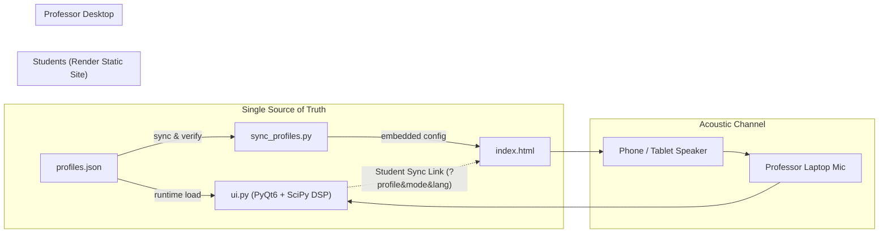

# Acoustic Spectrometer & Bird-Language Lab

An interactive didactic tool built for science workshops and **Noaptea Cercetătorilor** (European Researchers' Night). It lets students explore **sound waves, spectrograms, binary/hex encoding, FSK digital modulation, bioacoustics (bird song), and audio steganography** using nothing more than a phone speaker and a laptop microphone.

- **Students (Children):** Use the static web app hosted on Render — **[https://audio-spectrometer.onrender.com/](https://audio-spectrometer.onrender.com/)**
- **Professors / Facilitators:** Run the desktop PyQt6 receiver (`ui.py`) connected to a microphone and classroom projector.

---

## How It Works



---

## Quick Start — Students (Web App on Render)

1. Open **[https://audio-spectrometer.onrender.com/](https://audio-spectrometer.onrender.com/)** on a phone, tablet, or laptop (or open the exact link shared by your professor so the mode is pre-selected).
2. Switch language between **EN** and **RO** in the top-right corner.
3. **Send a Text Message as Sound:**
   - Type a short message (e.g., `Salut` or tap a quick preset like `HI`, `SALUT`, `SOS`). Romanian diacritics (`ă, â, î, ș, ț`) are automatically converted to clean ASCII.
   - Click **CONVERT TO HEX**.
   - Select the same **Acoustic Profile & Modulation Mode** shown on the professor's screen (check the colored badge at the top).
   - Turn phone volume to ~70–80%, point the speaker toward the professor's microphone, and press **TRANSMIT / SING MESSAGE**.
   - Tap **STOP TRANSMISSION** anytime to cancel.
4. **Hide an Image Inside Sound (Spectrogram Art):**
   - Upload a PNG/JPG image, choose **Phone (Fast)** or **Presentation (High Quality)**, and press **GENERATE SPECTROGRAM AUDIO**.
   - Play the generated audio while the professor's app is in **Full Visualizer Mode** to watch the picture appear in the spectrogram!
5. **Live Mobile Spectrometer:**
   - Use the built-in microphone spectrogram on your own phone to see voices, whistles, bird songs, and hidden images in real time. Use the **Frequency Range** selector (`0–8 kHz`, `0–10 kHz`, `Full`) to zoom in on the active band.

---

## Quick Start — Professors (Python Desktop Receiver)

### 1. Prerequisites
- Python **3.10+**
- A working microphone (built-in laptop mic or external USB mic)

### 2. Installation
```bash
python3 -m venv .venv
source .venv/bin/activate        # On Windows: .venv\Scripts\activate
pip install -r requirements.txt
```

### 3. Run the Receiver
```bash
python3 ui.py
```

### 4. Classroom & Projector Setup Tips
- **Select Microphone:** Use the **Microphone Input** dropdown at the top-left to pick your USB or laptop mic. The app runs at `44.1 kHz` and automatically falls back to the device's native rate (e.g., `48 kHz`) if needed.
- **Sync Students Instantly:** Click **Student Sync Link (Render URL)** to copy a pre-configured link like:
  `https://audio-spectrometer.onrender.com/?profile=canary&mode=4fsk&lang=ro`
  When students open it, their phones automatically match your profile, modulation mode, and language.
- **Projector Mode:** Check **Projector Font** to enlarge decoded student messages for visibility from the back of the classroom.
- **Back-to-Back Student Messages:** After ~1.5 seconds of silence, each decoded message is automatically archived into the message log and the receiver resets for the next student—no need to click **Clear Messages** between every student!
- **Image Spectrogram Demos:** Switch to **Full Visualizer Mode** (`0–10 kHz`) when students play Image-to-Spectrogram audio.

---

## Acoustic Profiles & Modulation Modes

All profiles are defined in [`profiles.json`](profiles.json) and shared between `index.html` and `ui.py`:

| Profile | Category | Frequency Band | Supported Modes | Waveform | Best Environment |
| :--- | :--- | :--- | :--- | :--- | :--- |
| **Classic Robot** (`classic`) | Classic Digital | `2.4 & 3.0 kHz` | `2-FSK` | Square wave | Noisy halls / classic binary intro |
| **Eurasian Blackbird / Mierlă** (`blackbird`) | Bird Language | `1.8 – 3.3 kHz` | `16-FSK`, `4-FSK`, `2-FSK` | Warm flute syrinx | Quiet room / general classroom |
| **Canary / Canar** (`canary`) | Bird Language | `3.0 – 4.95 kHz` | `16-FSK`, `4-FSK`, `2-FSK` | Bright chirp + trill | General classroom (recommended default) |
| **Great Tit / Pițigoi Mare** (`greattit`) | Bird Language | `3.9 – 6.15 kHz` | `16-FSK`, `4-FSK`, `2-FSK` | Snappy staccato | Classrooms with low-frequency chatter |
| **Goldcrest / Aușel** (`goldcrest`) | Bird Language | `5.2 – 7.9 kHz` | `16-FSK`, `4-FSK`, `2-FSK` | High delicate tweet | High background voice noise |

### Choosing a Modulation Mode
- **`16-FSK` (1 note per hex digit):** Fastest and most melodic; best in a **quiet room** with a good microphone.
- **`4-FSK` (2 notes per hex digit):** Best **balance** of speed, bird-song realism, and reliability.
- **`2-FSK` (4 notes per hex digit):** Widest frequency spacing; most **resistant to noisy classrooms** and science fair crowds.

---

## Keeping Python & HTML in Sync

Never edit profile frequencies or timings directly inside `index.html`. Instead:

1. Edit [`profiles.json`](profiles.json) (the single source of truth).
2. Sync into `index.html`:
   ```bash
   python3 sync_profiles.py
   ```
3. Verify parity & run the headless DSP loopback test suite:
   ```bash
   python3 sync_profiles.py --check
   python3 -m unittest discover -s tests -v
   ```

`ui.py` loads `profiles.json` directly at startup, while `index.html` embeds the synced copy so it works both on Render Static Sites and offline via `file://`.

---

## Deploying to Render (Static Site)

1. Push this repository to GitHub.
2. In Render, create a **Static Site** pointing to this repo:
   - **Build Command:** *(leave empty)*
   - **Publish Directory:** `.`
3. Render automatically serves root `index.html` at your site URL (`https://audio-spectrometer.onrender.com/`).

---

## Troubleshooting

- **Decoded text shows `▯` or misses characters in a noisy room:**
  - Switch both student and professor to **`2-FSK`** or **Classic Robot**.
  - Increase **Gate Margin (dB)** slightly (e.g., `14–18 dB`) if room chatter triggers false locks, or decrease it (`8–10 dB`) if the phone is far from the microphone.
  - Click **Reset DSP Defaults** if sliders were moved out of range.
- **Phone browser won't open the microphone for the Mobile Spectrometer:**
  - Browsers require **HTTPS** (which Render provides automatically) or `localhost` for `getUserMedia`.
- **No sound / distorted sound on phone:**
  - Turn off silent mode on iOS devices; keep volume around 70–85% to avoid speaker clipping.
- **Linux audio / PortAudio error when running `ui.py`:**
  - Install PortAudio: `sudo apt install libportaudio2` (Debian/Ubuntu) or `sudo pacman -S portaudio` (Arch).
